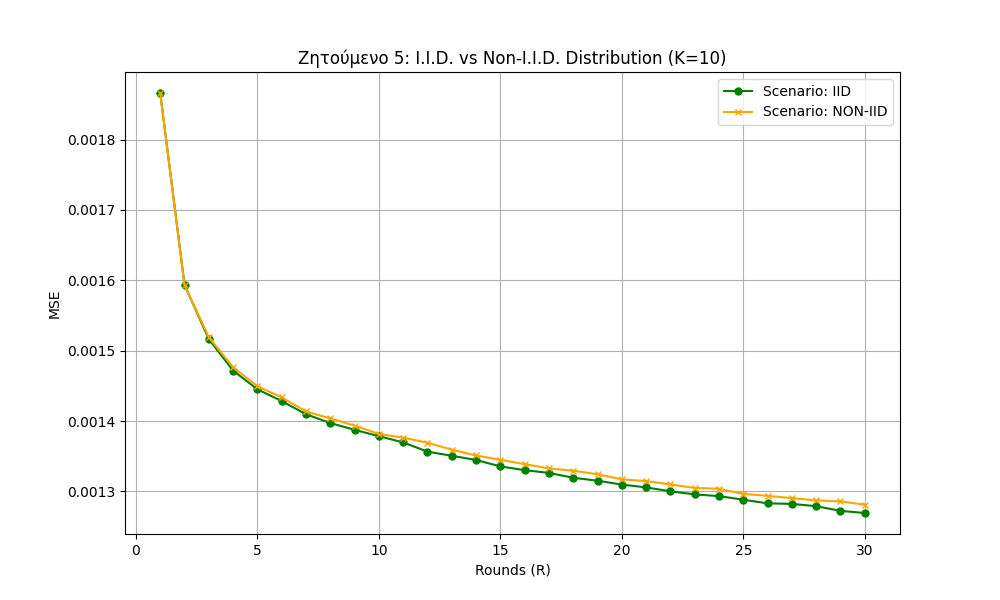
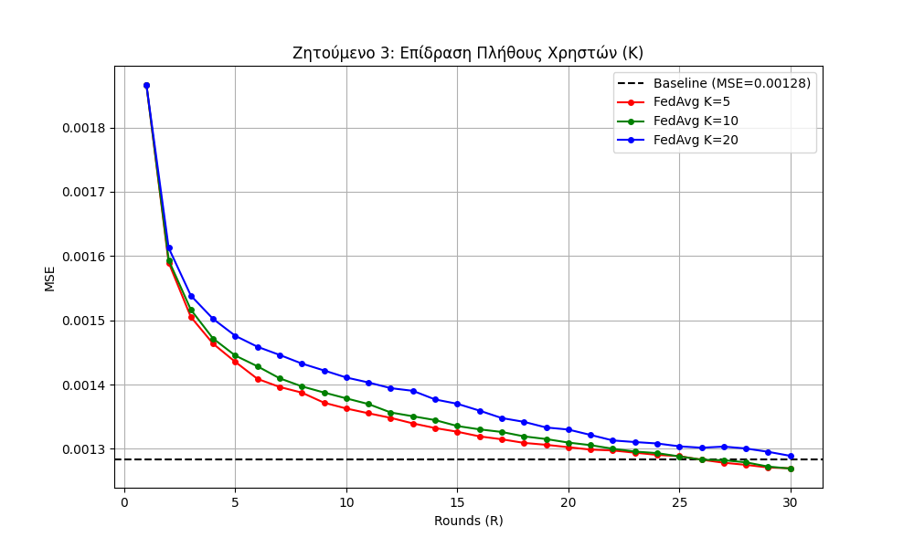
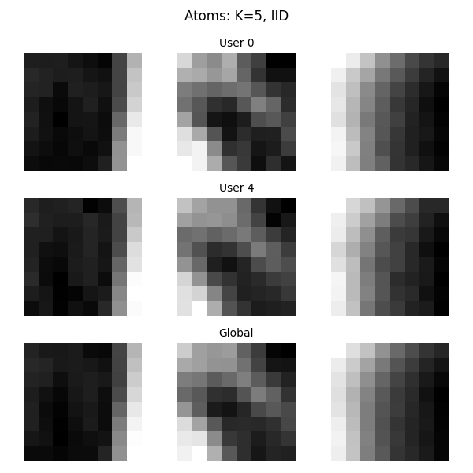

<h1 align="center">Federated Dictionary Learning </h1>


<p align="center">
  <em>A robust implementation of Federated Dictionary Learning simulating multiple clients utilizing Orthogonal Matching Pursuit (OMP) and the Method of Optimal Directions (MOD).</em>
</p>

<hr>

##  Table of Contents
- [About The Project](#-about-the-project)
- [Key Features](#-key-features)
- [Results & Visualizations](#-results--visualizations)
- [Installation & Usage](#-installation--usage)

---

##  About The Project

This project explores distributed machine learning by implementing **Federated Dictionary Learning**. It simulates a federated network where multiple clients (users) collaboratively train a global dictionary over local image datasets without exposing their raw data to a central server. The global aggregation is performed using the **FedAvg** algorithm.

The core sparse coding relies on:
* **OMP (Orthogonal Matching Pursuit)** for the sparse representation phase.
* **MOD (Method of Optimal Directions)** for the dictionary update phase.

---

##  Key Features

- **Centralized vs. Federated Baseline:** Evaluates the Mean Squared Error (MSE) degradation when moving from a centralized server to a federated setup.
- **I.I.D. vs Non-I.I.D. Data Distributions:** Tests the robustness of the federated network when data is equally distributed (I.I.D.) versus extremely biased across clients (Non-I.I.D.).
- **Scalability Testing:** Analyzes the impact of the number of participating clients ($K \in \{5, 10, 20\}$) on model convergence.
- **Hyperparameter Tuning:** Compares learning curves based on different dictionary sizes ($m$) and sparsity levels ($T$).

---

##  Results & Visualizations

Below are the key findings derived from the experimental simulations:

### 1. Data Distribution Impact (I.I.D. vs Non-I.I.D.)
The model demonstrates stable convergence, highlighting the slight performance variations between identically distributed data and non-I.I.D. edge cases.
<p align="center">
  
</p>

### 2. Impact of Network Size (K)
As the number of participating users ($K$) increases, the network requires more communication rounds to converge, while striving to approach the centralized baseline.
<p align="center">
  
</p>

### 3. Learned Dictionary Atoms
A visual representation of the sparse dictionary atoms learned locally by the clients, compared against the globally aggregated dictionary.
<p align="center">
  
</p>

---

##  Installation & Usage

### Prerequisites
Make sure you have Python installed. It is recommended to use a virtual environment.

```bash
# Clone the repository
git clone [https://github.com/Tsilpol/Federated-Learning.git](https://github.com/Tsilpol/Federated-Learning.git)

# Navigate to the directory
cd Federated-Learning

# Install dependencies
pip install -r requirements.txt

Execution
Ensure that your image dataset (.pgm files) is correctly placed in the ./dataset folder. To run the full simulation:

Bash
python src/federated_dict_learning.py
